<div align="center">


# CircleU

**Write down a hard moment. Understand it. Say what you mean.**

An iPhone app for difficult conversations: it turns a raw journal entry into a reflection, then into words you can actually say. Its AI runs entirely on the iPhone.


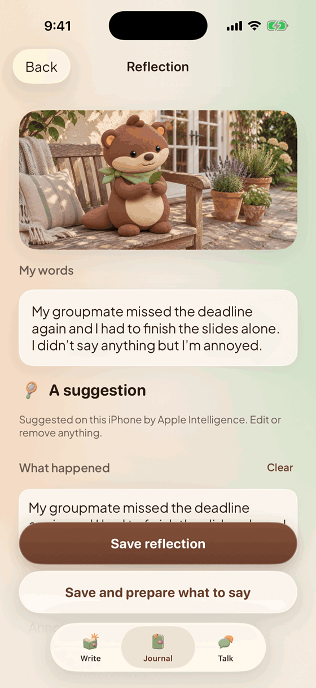&nbsp;&nbsp;
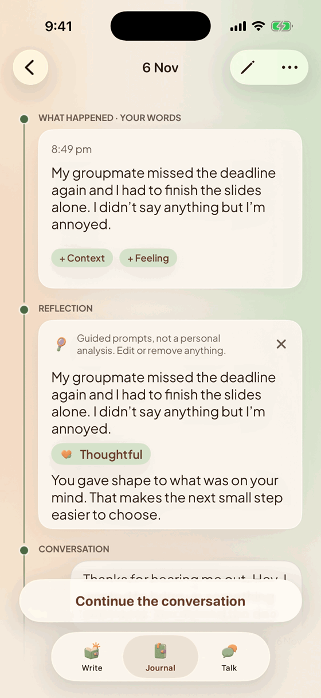&nbsp;&nbsp;
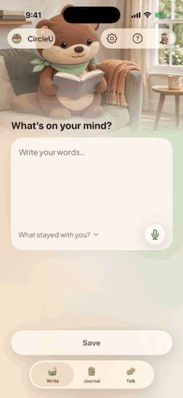

</div>

---

## At a glance

| | |
| --- | --- |
| **Problem** | People replay a hard conversation for days and still don't know what to say next time. Journaling apps stop at "how do you feel"; speaking coaches assume a presentation. |
| **For** | Students, new graduates and people new to a team or country, preparing for a talk with a groupmate, manager, friend, family member or partner. |
| **Solution** | One loop: **Write → Reflect → Talk → How did it go?** Each saved entry becomes a *moment* with a timeline of everything that grew from it. |
| **AI approach** | On-device Apple Intelligence that suggests and never decides. Every suggestion shows its source, and the app still works when the model doesn't. |
| **Status** | Version 1 shipped to TestFlight (June 2026). Version 3, described here, runs in the Simulator; physical-device validation is pending. |

## The product loop

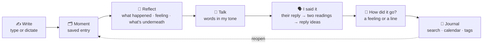

On the moment's page, the one main action is always the next stop that isn't done yet. Nobody has to learn the order.

## Features

### 1. Write and Reflect

<table>
<tr>
<td width="33%">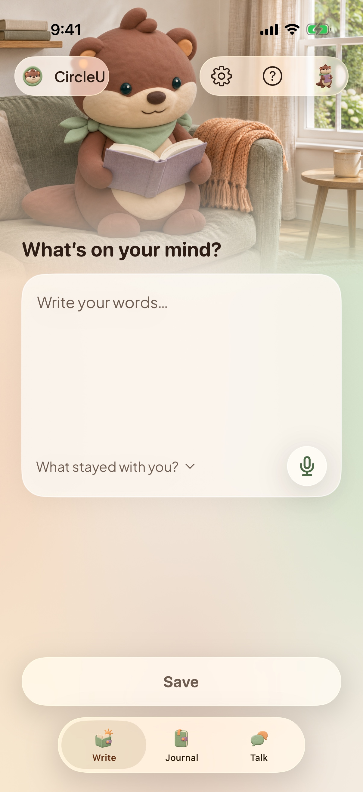</td>
<td width="33%">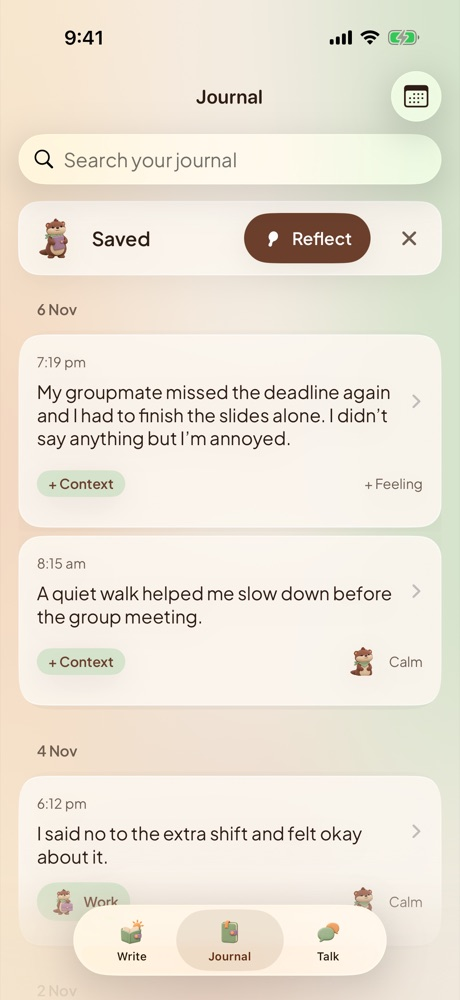</td>
<td width="33%">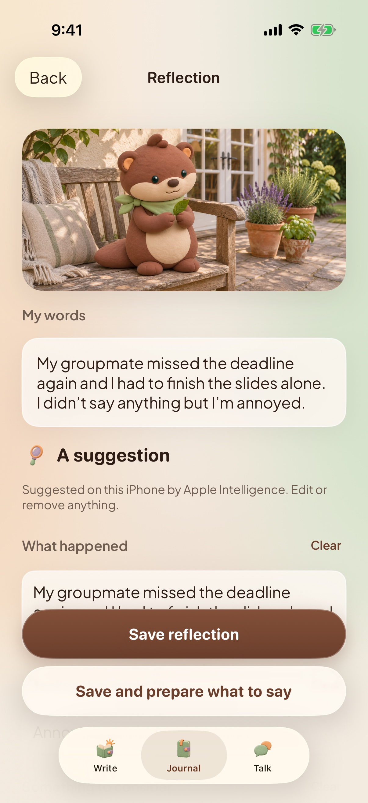</td>
</tr>
</table>

- **Write:** type or dictate on the device, or tap *What stayed with you?* for a guiding question that never changes your words. Unsent words survive a relaunch.
- **Reflect:** Apple Intelligence suggests what happened, a feeling and what's underneath, plus an optional next step. Everything is editable. With too few words it asks for more instead of guessing.

### 2. Talk: prepare what to say, then respond to what they said

<table>
<tr>
<td width="33%">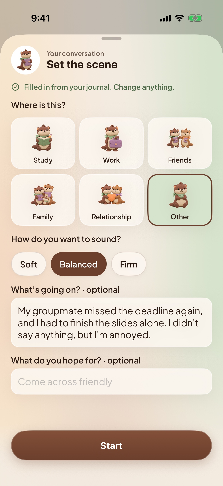</td>
<td width="33%">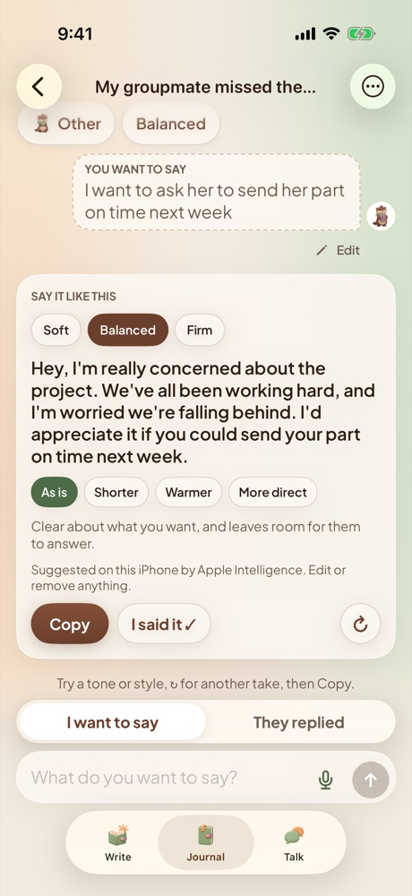</td>
<td width="33%">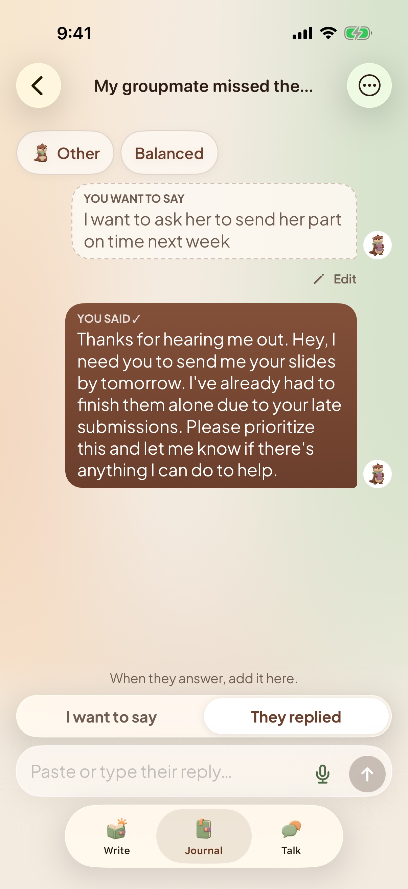</td>
</tr>
<tr>
<td width="33%">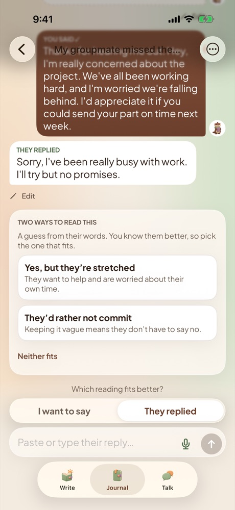</td>
<td width="33%">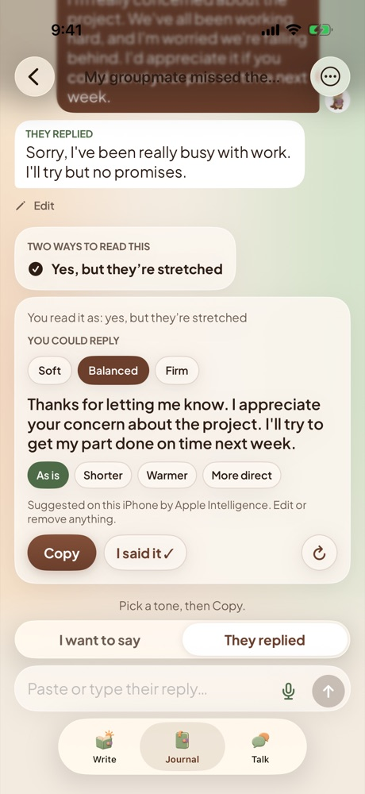</td>
<td width="33%">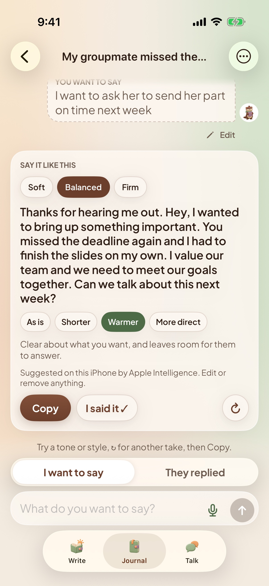</td>
</tr>
</table>

- **Set the scene:** where it is (Study, Work, Friends, Family, Relationship, Other) and how you want to sound (Soft, Balanced, Firm). It is filled in from the journal moment, and the tone is never guessed.
- **Say it like this:** one request returns the suggestion plus *Shorter*, *Warmer* and *More direct*, so styles switch instantly. **↻** asks for another take, and ‹ › keeps every take.
- **I said it:** the card turns into a *You said* bubble. Paste their reply.
- **Two ways to read this:** the app offers two possible readings of their reply, plus *Neither fits*. You choose, and only then get reply ideas.
- **Branches:** edit an earlier message and the thread starts again from there. The earlier branch stays one tap away, as in Claude or ChatGPT.

### 3. Moments and the journal

<table>
<tr>
<td width="33%">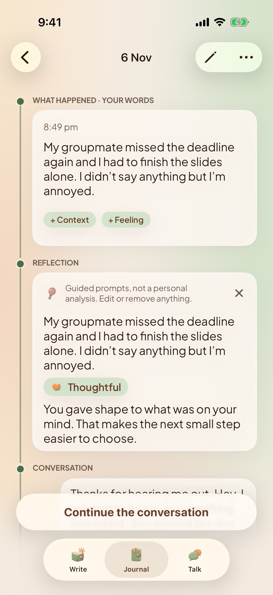</td>
<td width="33%">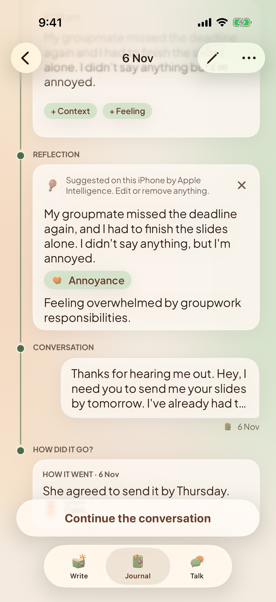</td>
<td width="33%">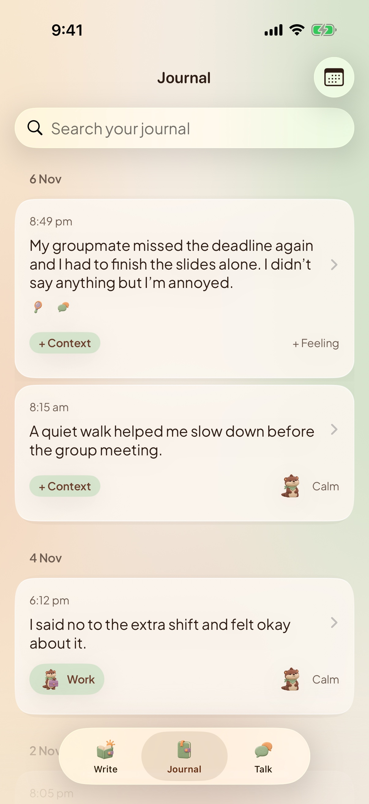</td>
</tr>
</table>

- **Moment timeline:** what happened, then the reflection, the conversation and how it went. Dots fill in and the rail grows as each stop is done.
- **How did it go?:** a feeling alone is enough. The Journal card keeps asking until it is answered, which closes the loop.
- **Journal:** entries by day, with search, a calendar, and context and feeling chips.
- **Talk home:** *From your journal* suggests moments that have a context but no conversation yet, then lists *Earlier conversations*.

### 4. First-run experience

<table>
<tr>
<td width="33%">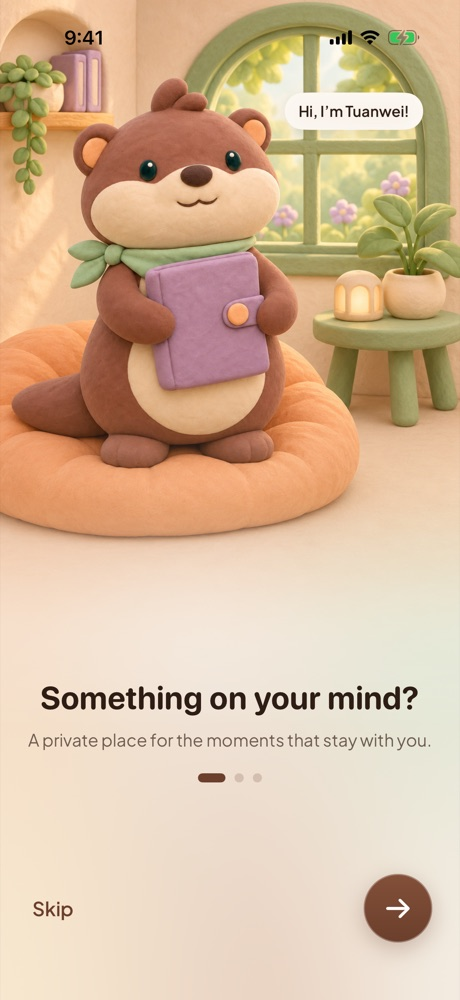</td>
<td width="33%">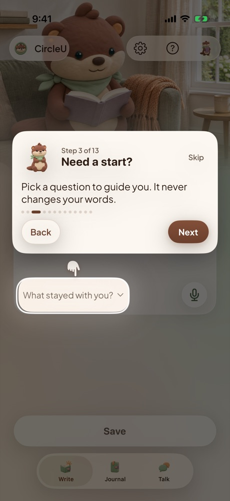</td>
<td width="33%">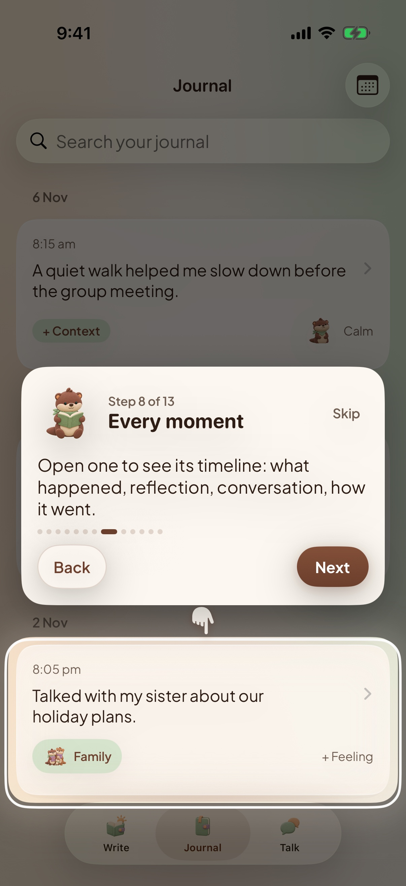</td>
</tr>
</table>

- **Welcome:** three scenes with Podo the otter. There is no account wall: *Get started* goes straight in, and *Log in* is only for recovering data from version 1.
- **Guide:** a 13-step tour across all three tabs. A spotlight lights one control and dims the rest, a paw points at it, and the otter changes pose at each step. It can be skipped at any step.

## AI product decisions

These are the rules the AI features were designed and tested against.

| # | Principle | How it shows up in the product | Why |
| :-: | --- | --- | --- |
| 1 | **Private by architecture** | Apple's on-device Foundation Models. No AI request leaves the phone, and the app has no upload path for new content. | Journal text is the most sensitive data a person has. Inference also costs nothing and works offline. |
| 2 | **Never a dead end** | When the model is unavailable or fails, guided templates built from the person's own words answer instead. | No core task depends on AI availability. |
| 3 | **Honest about the source** | Every suggestion says *Suggested on this iPhone by Apple Intelligence* or *Guided prompts, not a personal analysis*, plus one of six reasons (for example *Apple Intelligence is off in Settings*). | Trust comes from knowing what produced the text. |
| 4 | **Suggest, never decide** | Nothing is applied without a tap (Use this, Copy, I said it). The person's original words are never rewritten. | The person stays the author. |
| 5 | **No mind reading** | Their reply gets two possible readings and *Neither fits*, never one verdict. | A model can't know someone's motive. Offering two guesses keeps the judgement with the person. |
| 6 | **Don't call the model when it can't help** | Too few words get one prompt (*Add what happened and how it felt*) instead of a generated card. | It avoids confident nonsense. |
| 7 | **Latency by design** | One request returns the suggestion and all three styles; only ↻ calls the model again. | Instant switching and fewer calls. |

Supporting docs: the [AI acceptance cases](docs/qa/ai-acceptance-cases.md) list good and bad answers for 15–20 invented inputs, and the [fallback reasons](Circleu/Services/GuestJournal/GuestSuggestionEngine.swift) are each tested.

## How the product evolved

The repository holds three versions. Each one is visible in the code history.

| | **Version 1** · June 2026 | **Version 2** · Oct 2026 | **Version 3** · Nov 2026 (this README) |
| --- | --- | --- | --- |
| Who | Five-person team, Apple Foundation Program | Manh Tuan Nguyen, with Codex | Katherine (katherine0292), with Claude Code |
| Structure | Home · Journal · Tips · Circle · Profile | Today · Journal · Practice | **Write · Journal · Talk** |
| Entry | Account required | Guest-first, no account | Guest-first, plus a 13-step guide |
| Data | Firestore sync | SwiftData on this iPhone | Same, plus moments and outcomes |
| Coaching | *Live Coach* chat | Staged Practice: Prepare → Refine → Their reply | **Talk** thread with readings and branches, linked to the moment |
| AI | Cloud model, then Apple Intelligence | Apple Intelligence with guided fallback | Plus an input check, visible fallback reasons, and reply readings |
| Look | Liquid frosted glass, penguin mascot | Brand refresh, penguin scenes | Warm glass, Podo the otter, motion |

**Why each version changed:**
- **Version 1 → 2:** usability sessions and flow reviews ([flow review](docs/design/flow-review-2026-10-23.md)) found three problems: the account wall came before any value, Circles and rewards pulled attention from reflection, and sensitive text went to the cloud. See the [MVP definition](docs/product/mvp-definition.md).
- **Version 2 → 3:** a usability and heuristic review of Practice ([earlier session](docs/design/practice-usability-session-2026-10-30.md)) found three more:
  - its staged pages were hard to follow;
  - it stopped once the person said the words;
  - it wasn't linked to the journal.

  Talk, the moment timeline and *How did it go?* answer those, and the guide answers first-run confusion.

<details>
<summary>Version 1 screens</summary>

| Reflect | Insight | Journal | Quests | Circles |
| :-: | :-: | :-: | :-: | :-: |
|  |  |  |  |  |

</details>

## Architecture

```text
View (SwiftUI)          Write · Journal · Talk · Guide          Features/GuestJournal/
   ↓
ViewModel (@MainActor)  loading, saving, error states, drafts
   ↓ protocols
Store / Engine          GuestJournalStore · GuestConversationStore · GuestSuggesting
   ↓
SwiftData (V1→V6 migrations) · FoundationModels · Speech         Services/GuestJournal/
```

- A launch switch ([`AppStartup`](Circleu/App/AppStartup.swift)) keeps version 1 intact for existing TestFlight testers. Versions 2 and 3 share the guest app's code, which only Debug builds open. The guest graph never configures Firebase or analytics, and tests check this.
- Every store is a protocol, so tests use the same code with in-memory or deliberately failing stores. A failed save keeps the person's words and says so.
- Conversations are stored as attributed turns (*wording*, *their reply*, *context*, *outcome*). Old messages open as Talk threads without migration.

**Tech stack:**
- SwiftUI and Swift Concurrency (`@MainActor` ViewModels);
- SwiftData with versioned schemas;
- Apple Foundation Models;
- Speech and AVFoundation for on-device dictation;
- XCTest and XCUITest.

Version 1 also uses Firebase Auth and Cloud Firestore.

The full walk-through of every version, with a map of which folders belong to which (screens, data, AI and privacy), is in **[How CircleU works](docs/product/how-circleu-works.md)**.

## Quality

- **311 unit tests:** stores and migrations, ViewModels, the AI fallback, Talk branches and readings, the guide, and export.
- **28 UI tests:** the main path of each flow, including the keyboard at the largest text size and accessibility audits.
- **User stories with acceptance criteria:** [user-stories.md](docs/product/user-stories.md) maps each Given/When/Then to its test.
- **Copy lint:** the [screen content guidelines](docs/design/screen-content-guidelines.md) are enforced by `GuestCopyLintTests` (length limits, one primary action, banned wording).

## My contributions

**Version 1 (June 2026, 23 commits):**
- **UI:** built the liquid frosted-glass visual system (`PinguGlassKit`) and applied it to all 15 screens.
- **Live Coach:** redesigned it, splitting the coach's reply from its context and adding copy feedback.
- **Circles and Profile:** built the community feed, public circles on Firebase, and the account flow.
- **Privacy and wellbeing:** scoped each account's on-device data so two people on one phone never see each other's journal, and hid point scores in Profile.
- **Release:** App Store readiness (privacy manifest, signing and Firebase config kept out of Git).

**Version 3 (November 2026, 94 commits):**
- **Research:** usability and heuristic reviews of Practice and of the whole app, which led to the redesign.
- **Product and interaction design:**
  - the Talk thread (tone and style, ↻ for another take, edit to branch, two readings of a reply);
  - the moment timeline with *How did it go?*;
  - the 13-step spotlight guide;
  - the Write · Journal · Talk structure.
- **AI experience:**
  - no model call on too few words;
  - a visible reason whenever Apple Intelligence isn't used;
  - a reply-specific prompt;
  - [AI acceptance cases](docs/qa/ai-acceptance-cases.md).
- **UI and motion:** the warm glass restyle, Podo the otter across Welcome, scenes and avatars, and motion that respects Reduce Motion.
- **Quality:** unit and UI tests for Talk and the guide, user stories with acceptance criteria, and a dated [collaboration log](docs/agent-collaboration-log/README.md). The code was written with Claude Code.

Commit-level detail is in the [contribution map](docs/portfolio/katherine-contribution-map.md).

## Run it

Requirements: Xcode 26 and an iOS 26 Simulator for Apple Intelligence. iOS 17 is the minimum and uses the guided fallback.

```bash
git clone https://github.com/katherine0292/CircleU.git
cd CircleU
cp Config/Signing.xcconfig.example Config/Signing.xcconfig   # set your team for a device build
open Circleu.xcodeproj
```

- Run the **`CircleU Guest Review`** scheme to open the current app (version 3).
- The **`Circleu`** scheme opens version 1.
- Tests: scheme `Circleu` (unit) and `CircleuUITests` (UI).

```bash
xcodebuild test -project Circleu.xcodeproj -scheme Circleu \
  -destination 'platform=iOS Simulator,name=iPhone 17 Pro'
```

Contributor rules are in [AGENTS.md](AGENTS.md). The documentation index is at [docs/README.md](docs/README.md).

## Credits

Version 1 was built by the CircleU team in the Apple Foundation Program 2026. The engineering lead was Manh Tuan Nguyen, and the original repository is [tuannm3812/CircleU](https://github.com/tuannm3812/CircleU). Version 2 was built by Manh Tuan Nguyen; version 3 was redesigned and built in this fork. MIT License, see [LICENSE](LICENSE).
